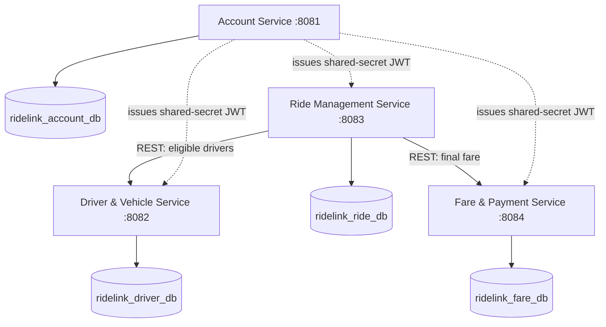

# RideLink architecture

Each service owns only its database. IDs such as `accountId` and `rideId` are database-generated numbers, starting at 1 within each table. References between services are stored as numbers, not cross-service foreign keys. Ride assignment deliberately uses a simple explainable algorithm: Driver Service returns available, area-matching profiles ordered by creation time, and Ride Service chooses the first result.
